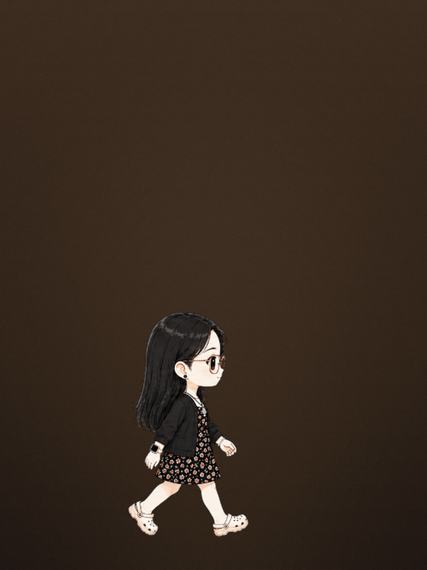
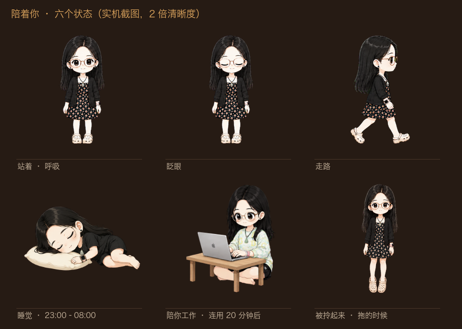

# 给一个人做的生日礼物

一个解谜风格的单页生日网站，加一只住在桌面上的宠物。
两样都是「一个人用一次」的东西，所以整套的设计目标不是通用，
是**让内容和代码彻底分开** —— 送礼的人只改一个 markdown 文件，别的什么都不用碰。

<p align="center">
  <br>
  <em>走路、被戳了会说话、拎起来会晃</em>
</p>
<p align="center">
  
</p>

## 网站是怎么走的

```
输密码 → 读信（往下滚）→ 停一会儿，「把信卷起来」浮现 → 点它，信卷成轴
      → 划一根火柴 → 火光里出现蛋糕 → 先许愿 → 吹蜡烛（对麦克风吹，或者点一下）
      → 生日快乐 → 屋里黑了，拖着手电筒摸黑找 → 找到盒子 → 打开 → 安装包弹出来
```

每一步之间可以往回退。闲置几秒会在下一个该点的地方浮出一行发光的字。

### 密码那一屏

默认就是一排格子，几位密码出现几个格子，不分大小写：

```markdown
## 密码
- 密码: WISH
- 密码框前面的词: 
- 密码框后面的词: 
```

两边的词留空就不显示。**但它俩是这一屏最好玩的地方** ——
把密码藏进一句话里，他填对的那一刻整行会读成一句完整的话：

```markdown
- 密码: MORE
- 密码框前面的词: ONE
- 密码框后面的词: YEAR
```

屏幕上是 `ONE ▢▢▢▢ YEAR`，填完变成 `ONE MORE YEAR`。
你可以按你们之间的暗号自己设计一个——名字缩写、某个日期、只有你们懂的那个词。
想不出来就留空，直接让他输密码，一样能用。

### 只改一个文件

`site/content.md`。所有文案、密码、图片路径、音乐、连引导提示都在里面：

```markdown
## 信

（第一段。先写一件具体的小事——一个画面、一句他说过的话。）

（第二段。）

## 落款

（署名）

（日期）
```

然后：

```bash
cd site
node build-content.js   # content.md → content.js
node build-site.js      # 打包成一个 HTML 文件
```

`build-site.js` 会把 CSS、JS、字体、图片、音乐**全部内嵌**成一个 HTML。
双击就能开，断网也能开，发给谁都能开。

## 桌宠

Electron。透明无边框窗口，浮在最上层，**按像素透明度做点击穿透** ——
只有画到人的那几个像素接收鼠标，头发缝里点下去直接穿到后面的窗口。

```bash
cd pet/app
npm install
npm start          # 跑起来看看
npm run dist       # 打包成 dmg
```

**她自己知道什么时候该做什么**：

| 情况 | 她会 |
|---|---|
| 23:00–08:00 | 睡觉 |
| 白天，连着用电脑超过 20 分钟 | 搬电脑过来陪你工作 |
| 白天，超过 3 分钟没碰键鼠 | 自己站着 / 溜达 |

用的是系统的 `powerMonitor.getSystemIdleTime()`，只知道「多久没动过键鼠」，不读任何内容。

**会说话**。戳一下、拎起来、到点提醒，冒气泡。
同一个「戳一下」，站着 / 睡着 / 工作 / 走路 / 被拎着是五组不同的语气；
连着戳会升级（第 3 / 5 / 8 下换一批）；每组抽句子时避开最近用过的。
台词全在 `pet/台词.md`，代码里一句都没写死。

## 做这个踩过的坑

都写在代码注释里了，这儿只挑几个最贵的：

**GPT 出的多帧素材没法直接用。** 它每一帧都会把整个画面重画一遍 ——
头发丝、桌子大小、人物比例全在飘。所以：

- 眨眼不是播 4 帧，是**身体锁死第 1 帧，只把眼睛那一块贴过来**（`只换眼睛.py`）。身体差异从 13~20% 降到 0.2%
- 工作那组按**桌子**对齐，不按人物包围盒（`切帧抠绿2.py`）。用色相找木头，写死 RGB 会在浅木桌上失效
- 各组帧不是一个尺度画的，睡觉那组大了 1.5 倍、工作那组 1.25 倍，代码里有张缩放表逐个缩回来

**被拎起来用代码物理，不用预制帧。** 帧不知道你在怎么拖，
只能循环同一段摆动。改成绕头顶抓取点旋转、目标角度由拖拽速度决定、弹簧+阻尼回正。

**画布必须按 `devicePixelRatio` 放大。** Retina 上一个 CSS 像素是两个物理像素，
不放大等于画完再被系统拉伸一倍。注意 `getImageData` 不认 ctx 的缩放，
命中测试的坐标要自己乘回倍率。

**`align-items: center` 会把长内容的顶部顶出可视区，而且滚不回去。**
浏览器不能滚到负值。信一长，前面几段就永远看不到了。用 `safe center` + `margin-block: auto`。

**macOS 上不做整包 ad-hoc 签名，系统会当成「应用已损坏」。**
那个弹窗只有「移到废纸篓」，没有任何打开的办法。
`pet/app/签名.js` 是 electron-builder 的 afterPack 钩子。
注意它**只能签合并后的通用包** —— 两个架构的临时目录各签一次的话，
`CodeResources` 不一致，合并那步会直接失败。

## 这个仓库里没有什么

- **信的正文、落款、密码** —— 换成了占位。那是写给一个人的
- **照片、音乐** —— 隐私和版权。`site/music/` 放三个 mp3 就能有背景音乐，
  读信 / 吹蜡烛 / 拆礼物 三段各一首，会自动淡入淡出地换
`site/photo/cake.png` 是网上找的图，只是为了让示例能直接跑起来，
**版权不明，别商用**，换成你自己拍的或者买的更好。

`pet/frames/` 里的形象是用 GPT 生成的 Q 版角色，
`pet/给GPT-直接复制.md` 里是完整的提示词，照着能做出你自己的那一只。

## 字体

`Caveat`（英文手写）和 `IBM Plex Mono` 都是 OFL 协议。
中文用系统自带的楷体，不内嵌 —— 省 5MB，而且比大部分免费手写体好读。
